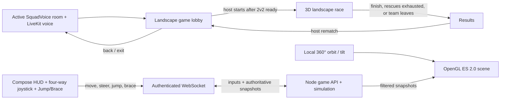

# Ropebound Game Guide

This is the working guide for understanding and changing Ropebound, the co-op race inside SquadVoice. It describes the **current working-tree implementation** and separately identifies design ideas that are not implemented. The Node game core is authoritative for gameplay rules; the Android app renders the scene, camera, and touch UI and sends player controls. Local source may be newer than the public APK or Render deployment; check Git and deployment state before assuming changes are live.

## 1. Game in one minute

Two teams race along a 100-unit 3D course. Each active runner has an ordered position in their team's rope chain. Players use a four-way joystick to move forward/back and steer left/right, tap **Jump**, and hold **Brace**. Dragging the playground rotates that player's camera through 360° horizontally; each player chooses their own view. The team must coordinate so the whole active chain gets to the finish. Hazard falls consume shared team rescues and return the team to its latest checkpoint. The first team with every active runner at the finish wins.

Ropebound runs inside an existing SquadVoice voice room. Opening the game keeps the LiveKit voice session alive. Voice transport is separate from the game simulation: the phone sends game controls to the token server, while voice audio goes directly between the phone and LiveKit.

## 2. Source of truth and implementation boundary

### Server owns gameplay rules

`token-server/ropebound/game-core.js` owns team state, race phase, movement, jump/gravity, rope constraints, hazard collisions, checkpoints, rescues, surge, progress, and winner selection. `token-server/ropebound/routes.js` exposes lobby actions over HTTP and uses one authenticated WebSocket for game inputs, snapshots, and latency probes. `token-server/server.js` authenticates the existing LiveKit participant token and mounts the game routes.

The client must send **inputs only**. It must not send or be trusted for positions, scores, checkpoints, teams, or win claims. The server calculates those values and returns snapshots. Keep this authority boundary when changing movement or adding mechanics.

### Android renders and controls

- `app/src/main/java/com/squadvoice/app/game/RopeboundGameScreen.kt` — lobby/race/results UI, landscape game view, input state, camera modes, touch controls, snapshot handling.
- `app/src/main/java/com/squadvoice/app/game/Ropebound3DScene.kt` — OpenGL ES 2.0 scene host, camera gestures and local camera transforms.
- `app/src/main/java/com/squadvoice/app/game/render/` — procedural 3D environment, mesh helpers, and runner rendering.
- `app/src/main/java/com/squadvoice/app/game/ui/RopeboundHudControls.kt` — four-way virtual joystick, Jump/Brace controls, camera buttons, settings dialog.
- `app/src/main/java/com/squadvoice/app/game/RopeboundApi.kt` — HTTP lobby actions, authenticated game WebSocket, and JSON-to-model parsing.
- `app/src/main/java/com/squadvoice/app/game/RopeboundGameAudio.kt` — local game sounds and ambience.
- `app/src/main/java/com/squadvoice/app/MainActivity.kt` — enters/exits Ropebound from the voice room, preserves the session, and requests landscape orientation while the game is open.

Android can animate between server snapshots for smooth rendering, but displayed gameplay state must reconcile to server snapshots. Avoid implementing a second, conflicting set of gameplay rules only on Android.

## 3. Current implemented rules

These values and behaviors are read from the current working-tree implementation. If this guide and `game-core.js` disagree, inspect the code and update this guide.

### Players, teams, and phases

- Maximum lobby: 10 total players; maximum 5 per team.
- Team IDs are `A` and `B`; each player is assigned to the smaller team when joining (ties favor A).
- **Start minimum is 2 active players on each team (4 players total)**, and every active lobby player must be ready. The host alone can start.
- The first player becomes host. If the host leaves or is marked offline, the earliest ordered online active player becomes host.
- Phases: `lobby` → `race` → `results`; a host rematch returns the game to `lobby`.
- Joining a new game player after the race starts is rejected. An existing player who reconnects during a race stays a spectator until the next round.
- Team changes are lobby-only. The host can arrange swaps. A non-host can switch themselves after the host enables free switching. Team changes/swaps clear readiness. Team capacity and a two-player minimum on the departing team are enforced.
- The server starts a randomly arranged course at match start and resets each team's checkpoint and three-rescue allowance.

### Movement and controls

The server course is 100 units long. `player.x` is longitudinal course progress; `lateralOffset` is cross-lane steering; `player.y` is jump height. The renderer maps those axes to world Z, X, and Y respectively. The UI may label course distance in metres.

| Rule | Current server behavior |
| --- | --- |
| Move | Input is `-1`, `0`, or `1` (backward, neutral, forward). Forward acceleration is 30 units/s²; top forward speed is 12 units/s. Reverse is capped at 45% of top speed. |
| Steer | Input is `-1` to `1` (left/right). Lateral acceleration is 20 units/s²; lateral speed is capped at 2.6 units/s; the player's lateral lane offset is clamped to ±1.25 units. |
| Diagonal input | The server normalizes the combined `move`/`steer` magnitude when it exceeds 1, so diagonal movement cannot exceed the input cap. |
| Neutral | Forward and lateral velocities are damped when their joystick axes return to neutral. |
| Jump | A rising-edge jump input while grounded sets vertical velocity to 16. Gravity is 25 units/s². Holding jump does not increase jump height. |
| Brace | Held input reduces acceleration to 55% of normal. In the wind hazard, not bracing subtracts 7 units/s² of horizontal velocity. |
| Input validity | Sequence numbers must strictly increase; `move` and `steer` must each be within -1..1; requests arrive no faster than one per 30ms. Inputs expire after 700ms without a refresh. |
| Server step | The Express server advances the simulation on a 50ms interval (20Hz); `tick` clamps each step to 50ms. |

Android sends active held controls about every 100ms and sends state transitions/jump pulses as needed. The joystick's up/down axis controls course progress; left/right shifts the runner across its lane. Jump is a tap/pulse and is accepted only while grounded. A jump request while airborne does nothing.

### Camera and local rendering

- The OpenGL ES scene is rendered by `Ropebound3DScene.kt`; procedural geometry, terrain, obstacles, runners, and effects live under `game/render/` and `game/obstacles/`.
- Drag anywhere on the exposed playfield to orbit the local camera. Horizontal yaw wraps around the full 360°; vertical pitch is intentionally clamped to keep the view usable and avoid camera flips. Presets include Follow, 3D orbit, and Top.
- Camera state is local to each device and never enters game input, snapshots, collision calculations, or opponent state. Teammates may look from different angles while seeing the same authoritative race.
- Compose overlays the HUD and controls over the GL view. The four-way joystick controls movement; Jump and Brace are separate. Avoid placing a camera drag target over touch controls, Android system bars, or the active voice/mute controls.
- The renderer interpolates snapshots and may predict the local runner for responsiveness. Any local prediction must reconcile to the next authoritative server snapshot.

### Rope and team movement

- Teammates are ordered by join order; adjacent runners form the chain.
- Maximum 3D rope-link distance is 7.5 units. The server makes multiple constraint passes each tick, accounting for vertical separation.
- When a pair stretches too far, the leader is pulled backward more than the trailing runner is pulled forward; velocities are softened. If runners pass each other, the server resolves them around their midpoint.
- Rope tension in the snapshot is the maximum link length divided by 7.5, clamped from 0 to 1. The UI shows this value and plays a cue when it becomes high.
- Team progress for race completion/checkpoints is based on the **slowest active runner**. The progress marker displayed in snapshots is the team's **average** runner position. Thus a fast leader does not finish the team alone.
- The rope is never a damageable object; there is no rope-health mechanic.

### Checkpoints and rescues

- Course checkpoints are at 8, 19, 30, 40, 50, 64, and 80 units.
- A team's checkpoint advances only once its slowest active runner passes that checkpoint.
- Each team starts with 3 rescues per race.
- A pit/river fall, bridge break, or lava landing triggers a team-wide recovery: all active team runners reset in formation at that team's latest checkpoint, movement/jump/brace state is cleared, and one rescue is consumed.
- If the team has no rescues left when a recovery is triggered, the match ends and the other team wins.
- The checkpoint formation is spread across a safe lane per checkpoint. Course hazard slots are chosen to avoid placing a hazard on those recovery lanes.

### Obstacles and course randomization

The server starts with six hazards and places them in randomized safe course slots. The course is sorted by final position after placement; the hazard order and locations can vary each race. The definitions below show current widths in the code (the current local edits shortened several spans):

| Hazard ID | Current width | Hint/action | Current collision/result |
| --- | ---: | --- | --- |
| `pit` | 4.5 units | Jump | A grounded runner inside the pit falls; if the runner drops below the course, the whole team uses a rescue. Jump across to avoid it. |
| `boulder` | 2.5 units | Jump | If a runner overlaps it below 2.4 height units, they bump back to a point before the obstacle and must retry with a jump. |
| `river-bridge` | 6 units | Keep moving | Remaining inside the bridge span for 800ms breaks it and triggers a team rescue. |
| `river-gap` | 5 units | Jump | A grounded runner enters the fall/water recovery path; clear the span while airborne. |
| `wind-tunnel` | 6.5 units | Brace | Not bracing applies backward drag while inside. Bracing reduces acceleration, so time it with the team. |
| `lava` | 6.5 units | Jump | A grounded runner in lava triggers a burst; staying grounded there for 400ms triggers a team rescue. |

Each hazard also has a lead-in hint in its definition. The UI warning is computed from the **front/leading runner's progress** so the team sees the next obstacle early. The snapshot includes obstacle positions for drawing, and the hint reports label, action, distance, and whether the leader is inside the hazard.

The screenshot-era course positions used to be fixed. Current `buildRandomCourse()` shuffles the six hazard types and fits them into distinct slots from `COURSE_SLOTS`; obstacle ranges therefore move between matches while retaining their widths and staying away from checkpoint lanes. If changing obstacle spacing or jumpability, inspect both the collision ranges and the randomized slots, not just the drawing in Compose.

### Squad Surge

Squad Surge is a temporary teamwork reward, not an input the player activates directly:

- Requires at least two active runners, every runner grounded and holding forward, nobody bracing, each adjacent horizontal gap at most 68% of the rope limit (5.1 units), and no runner inside any hazard.
- Those conditions charge for 1.2 seconds.
- Activation lasts 2.4 seconds; forward acceleration and maximum forward speed use a 1.2 multiplier.
- After activation, cooldown is 8 seconds. Charge decays when the team stops meeting the requirements; it clears during cooldown.
- Each activation increments the team's surge count and emits a team-scoped effect.

### Disconnects, leaving, and spectators

- The Android game sends heartbeats about every 3 seconds. Server cleanup marks a player offline after 8 seconds without a heartbeat/input.
- Offline runners are removed from the active race chain and are displayed as offline/spectating. Their team continues with remaining active players. If a team has no active runners, the other team wins (or the result is empty if both are empty).
- A disconnected player who returns while the race is in progress does not re-enter that race; they can play the next round/rematch.
- In lobby/results, offline player records are removed after 30 seconds. A reconnect within that window can reuse the identity; in lobby it returns them to the active roster and clears readiness if they had gone offline.
- There is no implemented “AFK but still connected” kick/warning timer, despite a proposal in the design notes.
- Explicitly leaving removes a player; if that empties one team during a race, the other team wins. Game exit from Android calls `/games/leave`, then returns to the voice room.

### Finish and results

- A team finishes when all its active runners reach at least 99.5 units.
- The first team detected as finished ends the race immediately. If both teams meet the finish condition in the same server tick, the result is a tie.
- A rescue exhaustion or a team having no active runners can award the match to the other team before the finish.
- Only the host can request a rematch. The server resets players, ready flags, checkpoints, rescue counts, surge state, course hazards, effects, and race times, then returns to the lobby.

## 4. Lobby and race UI

### Lobby

The current Compose lobby shows Team A/B roster, host, ready state, ping, team switching/swap controls, a ready button, and a host-only start button. It communicates the two-runners-per-team requirement. Server validation remains authoritative if a client button is enabled incorrectly.

### Race

The landscape Compose screen keeps the HUD, voice/settings actions, errors, and touch controls in Compose. The playfield is rendered as a perspective 3D scene by `Ropebound3DScene.kt` using Android OpenGL ES 2.0. The local camera has Follow, 3D Orbit, and Top presets; dragging across the playfield rotates the camera through a full 360° horizontal orbit with bounded vertical tilt. Each phone has its own camera state. The scene builds low-poly terrain, layered sky and mountains, clouds, grass, trees, characters, obstacles, flowing water, fire, and a sagging rope bridge. Bridge planks and rails flex in response to nearby player movement and jumping. Runner models have clothing, facial features, shoes, packs, and harnesses; the renderer draws the rope chain while server constraints remain authoritative. Server longitudinal progress is normalized to 0–1 in snapshots, while obstacle/checkpoint positions use course units; convert between these units when positioning scene elements. Name and ping badges are projected above visible teammates and move with the camera. The scene does not show opponent runner positions. Race errors use a dismissible bottom banner.

Water ripples, grass sway, bridge flex, fire flicker, embers, and runner motion are client-side render effects. The geometry is procedural and follows the server-provided obstacle spans, so randomized course placement remains aligned. Collision, course positions, progress, and recovery remain server-authoritative. Canva output is only a visual reference and is not placed in the game as a flat background or sprite.

Controls: the four-way joystick moves forward/backward and steers left/right; combined axes allow diagonals and the server normalizes their magnitude. Tap Jump while grounded and hold Brace for the wind hazard. Drag the exposed playfield to rotate the local camera; camera movement is not sent to the game server. Audio cues and ambience are local assets under `app/src/main/res/raw/` and managed by `RopeboundGameAudio.kt`; game audio uses Android's game/media route so it does not replace the LiveKit voice call route.

### Results

The result screen shows team win/loss/tie and race statistics, and offers rematch to the host or exit to voice. Keep voice available through lobby, race, and results.

## 5. Game API and snapshot contract

Every game request authenticates with the existing LiveKit participant JWT in `Authorization: Bearer <token>`. The server checks the HMAC signature, expiry, `roomJoin: true`, and that the token's room matches the supplied six-character `roomCode`.

| Endpoint | Method | Purpose |
| --- | --- | --- |
| `/games/join` | POST | Join/create the in-memory game lobby for the voice room; returns initial snapshot. |
| `/games/state?roomCode=...` | GET | Fetch one current snapshot. |
| `/games/realtime?roomCode=...` | WebSocket | Authenticated game channel; streams snapshots about every 100ms and accepts `ping` and `input` JSON messages. |
| `/games/heartbeat` | POST | Legacy HTTP heartbeat retained for compatibility; current Android game uses the WebSocket ping message once per second. |
| `/games/team` | POST | Choose a team in lobby. |
| `/games/team-switching` | POST | Host toggles free team switching. |
| `/games/swap-team` | POST | Swap two players from opposite teams in lobby. |
| `/games/ready` | POST | Set current player's ready state. |
| `/games/start` | POST | Host starts a valid, ready lobby. |
| `/games/input` | POST | Legacy HTTP input retained for compatibility; current Android game sends `seq`, `move`, `steer`, `jump`, and `brace` over the WebSocket. |
| `/games/rematch` | POST | Host resets the results match to lobby. |
| `/games/leave` | POST | Leave/remove the player. |

For REST lobby actions, `roomCode` must be included in the JSON body. `/games/state` and `/games/realtime` use the `roomCode` query parameter. The WebSocket sends the same participant JWT in its `Authorization` header. Keep the room code and bearer token aligned: voice-room connection does not implicitly authorize a separate game connection. WebSockets reduce repeated HTTP request overhead for frequent game messages; they cannot remove latency caused by the player's distance from the Render region or a sleeping free instance.

Snapshots include phase, both teams' counts and aggregate progress, viewer team/host/spectator state, checkpoints, winner, notice, hazard hint, temporary effect, obstacle definitions, duration, and surge counts. During a race, each viewer receives full runner/rope/spectator details only for their own team; the other team's individual runner positions are omitted. This is a privacy boundary—preserve it when adding snapshot fields.

## 6. Current code vs design ideas

`docs/ropebound-design.md` is the broader product design and contains future ideas. It is not proof that those mechanics exist. The current code includes the 3D renderer, local orbit/follow/top camera modes, four-way joystick steering, Jump, Brace, WebSocket gameplay, and server-randomized placements for six hazard types. It does **not** implement all-player push-to-talk, team-only voice modes, reconnect pause windows, AFK warnings/kicks, selectable named levels, alternate route choices, collectibles, or Redis-backed state.

The game core is held in memory by the token-server process. Restarting Render clears active game simulations. Game traffic uses the authenticated WebSocket described above, not server-sent events. Check the deployed commit and test multiplayer behavior before assuming a local implementation is live or production-scale.

## 7. How to make independent gameplay changes

Use the player goal and constraints to make ordinary design choices without asking for approval on every tuning decision:

1. Identify the player problem (for example, a jump feels impossible or the character looks airborne).
2. Find the authoritative mechanic in `game-core.js` and the corresponding visual/input code in `RopeboundGameScreen.kt`.
3. Change the smallest coherent set of server rules and client rendering. For obstacles, align collision span, randomized placement slot, hint text, and drawn geometry.
4. Keep rules deterministic and legible: give warning, a clear player action, and a recoverable consequence. Preserve team play, the unbreakable rope, the checkpoint loop, and server authority unless the product direction changes.
5. Update this guide and `docs/ropebound-design.md` when decisions change. Label proposals as future ideas, not current behavior.
6. Validate the game with at least 2 active runners per team for the current implementation, and verify voice stays connected. Physical-device multiplayer is needed to judge touch feel and network behavior.

Some current game behavior may exist only in local source and not in the APK or Render deployment. Before editing, inspect `git status --short` and the diffs; before asking another player to test it, confirm the change has been built and deployed to the correct target. Do not treat this guide as proof that a specific build is public.

## 8. Suggested playtest checklist

- Join Ropebound from an active voice room and confirm voice stays connected.
- Confirm a lobby with fewer than two players on either team cannot start; ready every player and confirm only the host can start.
- Try all joystick directions, diagonals, Jump, and Brace on more than one Android phone; verify releasing controls stops both axes and Jump only fires from ground.
- Rotate the camera all the way around, tilt up/down, and restore Follow/Orbit/Top. Confirm camera movement does not move the runner or interfere with touch controls.
- Observe the rope near maximum stretch and verify it constrains runners without breaking or launching them.
- Try each hazard action and recovery. Check checkpoint formation does not spawn inside a hazard.
- Coordinate forward running as a team to charge/activate Squad Surge.
- Disconnect a player for more than 8 seconds, reconnect during a race, and verify spectator behavior; then verify rematch returns the player to lobby.
- Finish with the whole team, verify result/winner/tie behavior and host rematch.
- Repeat a race to verify randomized hazard placements remain visible, hinted, and fair.

## 9. More context

- Product design and intended future direction: `docs/ropebound-design.md`.
- System/deploy diagram: `docs/SYSTEM-FLOW.md`.
- General repository, Render, GitHub, and APK handoff: `docs/HANDOFF.md`.
