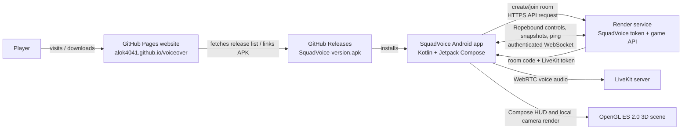
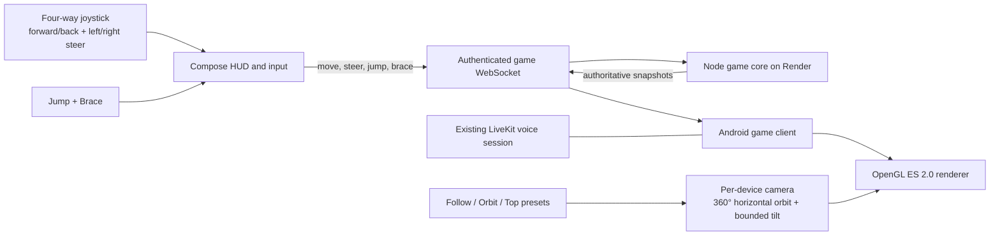

# SquadVoice System and Publishing Flow

Use this diagram as a quick map before editing or deploying. The website, Android app, API server, and LiveKit voice service are separate pieces.

For detailed current rules and actual-vs-planned mechanics, read `docs/ROPEBOUND-GAME-GUIDE.md`. For repo state and deployment details, read `docs/HANDOFF.md`.

## What players use



## Ropebound game architecture



The server owns movement, collisions, rope constraints, checkpoints, and match results. Android renders the server snapshots and handles local presentation. The four-way joystick sends forward/backward `move` and left/right `steer`; diagonal input is normalized by the server. Camera orbit and tilt are local to each phone: they do not change gameplay coordinates or another player's view. Horizontal yaw wraps through 360°; vertical tilt stays within a safe range to avoid flipping the view. Voice continues over LiveKit while game state uses the Render WebSocket.

## What gets published where

```mermaid
flowchart TD
    SRC[GitHub repo\nalok4041/voiceover]
    SRC -->|app/ source| BUILD[Build Android APK\n./gradlew :app:assembleDebug]
    BUILD -->|upload asset SquadVoice-v1.2.7.apk| RELEASE[GitHub Release\nversion tag v1.2.7]
    RELEASE -->|website queries GitHub Releases| SITE[GitHub Pages\npublic download page]

    SRC -->|token-server/ source| RENDER[Render web service\nAPI + game routes + hosted site copy]
    RENDER -->|health check| HEALTH[/health]
    RENDER -->|serves static homepage copy| RENDER_SITE[token-server/public/index.html]
    SRC -->|index.html| SITE
```

The repository source is the shared origin, but publishing is a separate action for each destination. Confirm GitHub Pages and Render deploy settings before assuming a push automatically updates them. A Render deploy is needed for backend/game-core changes; an APK release is needed for Android UI/client changes. Website fallback version text is duplicated in `index.html` and `token-server/public/index.html`.

## Runtime sequence

1. Player installs the APK linked by the GitHub Pages site.
2. Android app calls the Render API to create or join a voice room.
3. Render validates the request, creates/restores the room, and returns the room code, LiveKit server URL, and participant token.
4. Android connects to LiveKit for voice. Voice audio is sent directly between the app and LiveKit; it does not go through the Render API.
5. Ropebound lobby actions use HTTP. During play, the four-way joystick and action controls send `move`, `steer`, `jump`, and `brace` plus ping probes over an authenticated WebSocket. Render authenticates the room participant and calls the simulation in `token-server/ropebound/game-core.js`.
6. Render streams authoritative game snapshots over the WebSocket. Android interpolates them in the OpenGL ES scene; each player's 360° horizontal camera orbit and bounded tilt remain local to that phone.

## Code-to-runtime map

| Concern | Source location | Runs or publishes at |
| --- | --- | --- |
| Android screens and voice client | `app/src/main/java/com/squadvoice/app/` | Installed APK on Android phones |
| Ropebound Android screen/API client | `app/src/main/java/com/squadvoice/app/game/` | Installed APK; calls Render |
| Ropebound joystick, actions, and camera controls | `app/src/main/java/com/squadvoice/app/game/ui/RopeboundHudControls.kt` and `Ropebound3DScene.kt` | Installed APK; local touch input and camera |
| Ropebound 3D renderer and procedural scene | `app/src/main/java/com/squadvoice/app/game/render/` | Installed APK; draws server snapshots |
| Voice room/token endpoints | `token-server/server.js` | Render service |
| Game HTTP routes/authentication | `token-server/ropebound/routes.js` | Render service |
| Authoritative game simulation/hazards | `token-server/ropebound/game-core.js` | Render service |
| Public download page | `index.html` | GitHub Pages |
| Render-hosted copy of download page | `token-server/public/index.html` | Render service root `/` |
| APK download | GitHub Release asset named `SquadVoice-v1.2.7.apk` (current release candidate) | Linked from the website |

## Current project endpoints

- Download page: <https://alok4041.github.io/voiceover/>
- Render API and Render-hosted page: <https://voiceover-1.onrender.com>
- Render health check: <https://voiceover-1.onrender.com/health>
- GitHub releases: <https://github.com/alok4041/voiceover/releases>

On a physical phone, use the HTTPS Render endpoint (or a reachable LAN IP during local development). `10.0.2.2` is for an Android emulator, and `127.0.0.1` on the phone points back to the phone itself.
